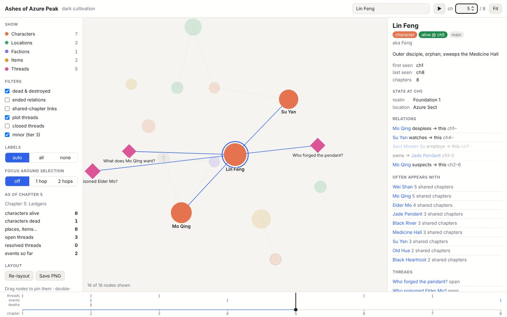
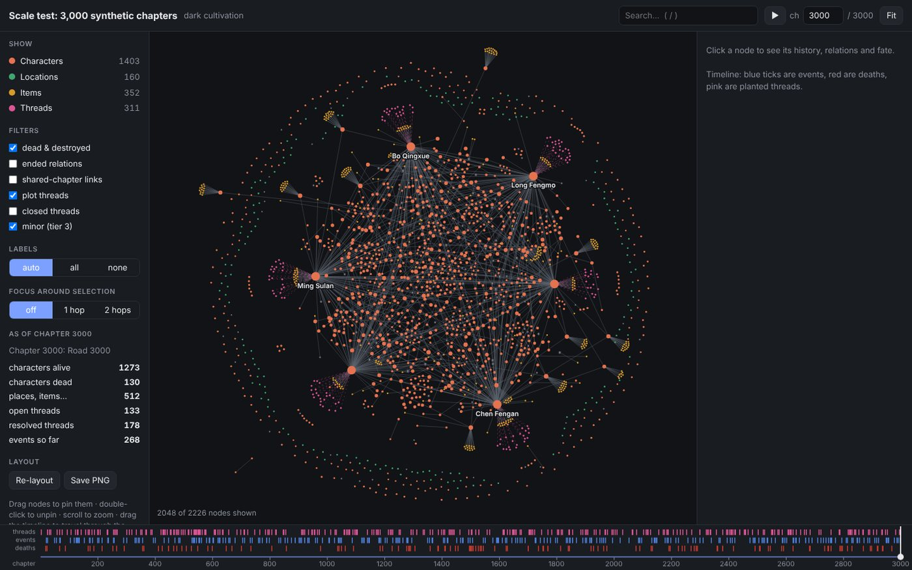

<div align="center">

# Inkgraph

**Write a 3,000-chapter novel with Claude Code and never lose the plot.**

A Claude Code skill that gives your AI co-writer a persistent memory: a story graph of every character, death, relationship, item, and plot thread, plus an offline interactive story map.

[](https://docs.claude.com/en/docs/claude-code/skills)
[](#install)
[](#install)
[](#the-story-map)
[](LICENSE)

**[▶ Live demo: example story](https://soumik766.github.io/Inkgraph/)** · **[▶ Live demo: 3,000-chapter scale test](https://soumik766.github.io/Inkgraph/scale.html)**



</div>

## The problem

AI writing tools forget. By chapter 200, the dead mentor is giving advice again, the sword the hero lost in chapter 90 is back in his hand, and the mystery planted in chapter 12 is never paid off. Context windows can't hold a webnovel, and pasting "previously on…" summaries doesn't scale.

## How Inkgraph solves it

Claude never rereads your book. Before each chapter it pulls a **compact, prioritised context bundle** from the graph: recent chapter summaries, the current state of everyone in the scene, what they own, who they're allied with or hunting, and which foreshadowing is due. After each chapter, every change is **staged, shown to you as a diff, and saved only when you approve**.

```
context → draft → style pass → continuity check → summary → staged changes → diff → your OK → commit
```

## Features

- 🧠 **Story graph.** Characters, locations, factions, items, powers, and concepts. Each relation has a start and end chapter, items change hands, and deaths carry a recorded fate.
- 🧵 **Foreshadowing ledger.** Plot threads with a planted chapter, a payoff deadline, and overdue warnings.
- 🔎 **Continuity check.** Flags a dead character speaking, an item appearing without its holder, a missing character showing up, or new names not yet in the graph.
- ✍️ **Voice matching.** `ink style` measures your sample chapters (sentence and paragraph rhythm, dialogue share, tag habits, dashes, adverbs) and flags drafts that drift from them or use AI-sounding phrases.
- 🗺️ **Offline story map.** A single HTML file with time travel through chapters, state-at-any-chapter, and a timeline of deaths, events, and threads (details below).
- 📚 **Layered memory.** Chapter summaries roll up into arc summaries, so chapter 2,400 knows about chapter 40.
- ✅ **Safe by design.** Every change is approved before it's saved, with multi-level undo, atomic writes, and compressed snapshots.
- 📄 **Export** to Word (.docx), plain text, or Markdown, from approved chapters only.
- 🗂️ **Obsidian vault** generated alongside, if you like Obsidian's graph view.

Works for any genre with word limits: webnovels, light novels, xianxia and cultivation, LitRPG, epic fantasy series, mystery, romance, and serial fiction for Royal Road, Wattpad, or Webnovel.

## Install

```bash
git clone https://github.com/Soumik766/Inkgraph ~/.claude/skills/inkgraph

# Windows (PowerShell)
git clone https://github.com/Soumik766/Inkgraph "$env:USERPROFILE\.claude\skills\inkgraph"
```

Requires Python 3.9+, standard library only. [pandoc](https://pandoc.org/installing.html) is optional and only needed for Word export.

## Quick start

Open Claude Code in an **empty folder** for your book (not inside the skill folder) and say:

> Start a new novel with inkgraph. Dark cultivation, close third person, past tense, 2,000–3,000 words per chapter. Here are 3 sample chapters for the style…

In later sessions:

> Next chapter. Lin Feng confronts Mo Qing at the river.
> Show me the story map. · What happened to Elder Mo? · Who has the Jade Pendant now? · Export chapters 1–50 to Word.

Want to look before you write? Open [`examples/ashes-of-azure-peak`](examples/ashes-of-azure-peak) in Claude Code. It's an 8-chapter mystery with a poisoning, a stolen pendant, and a foiled assassination, fully tracked.

## The story map

`ink graph` writes `story-map.html`: one self-contained file with no CDN and no internet needed. It uses a hand-written canvas renderer with a Barnes-Hut layout, so it stays smooth with thousands of characters.



- **Time travel.** Drag the timeline or press play. Characters appear when introduced, deaths show as ✝, and relations start and end on schedule.
- **State at any chapter.** Click a character to see their realm, location, and status *as of that chapter*.
- **Timeline lanes** for planted threads, events, and deaths, with hover details.
- **Search** (`/`), **focus mode** (1–2 hops), type and status filters, and *shared-chapter links* showing who actually appears together.
- Light and dark themes, phone layout, draggable and pinnable nodes, cached layout, **Save PNG**.

## Is my writing private?

Yes. Inkgraph is a local tool. Your book lives in its own folder on your machine, and nothing is uploaded anywhere. This repository contains only the skill. As an extra guard, `ink init` refuses to create a novel inside the skill folder, and the repo's `.gitignore` blocks project files, so a book can't be committed here by accident.

## Performance

Measured on a synthetic 3,000-chapter, 6.2-million-word saga with 1,900 entities:

| operation | time |
|---|---|
| commit a chapter | ~0.2 s |
| build context for the next chapter | ~25 ms |
| continuity check a draft | ~75 ms |
| build the story map | ~0.1 s (renders at ~1 ms/frame) |

## Commands at a glance

Claude runs these for you. You never have to type them.

| | |
|---|---|
| stage | `add` `set` `kill` `alias` `note` `link` `unlink` `move` `thread` `event` `batch` |
| review | `diff` `commit` `discard` `undo` |
| read | `context` `check` `style` `show` `find` `list` `threads` `status` `doctor` |
| arcs | `rollup` `arc` |
| output | `graph` `render` `export` |

Full reference: [`references/cli.md`](references/cli.md). The workflow Claude follows: [`SKILL.md`](SKILL.md).

## Project layout

```
my-novel/
├── CLAUDE.md               # tells Claude this is an inkgraph project
├── bible/                  # style.md · world.md · outline.md · samples/ (your reference chapters)
├── chapters/               # draft/ · final/  (final = approved; the only source for export)
├── summaries/              # chapters/ · arcs/
├── graph/                  # generated Obsidian notes
├── story-map.html          # generated offline map
├── export/                 # .docx / .txt / .md
└── .inkgraph/              # graph.json (source of truth) · staged ops · history · snapshots
```

## Contributing

Issues and PRs are welcome. Run the tests with:

```bash
python3 -m unittest discover -s tests
```

## License

MIT © Soumik
